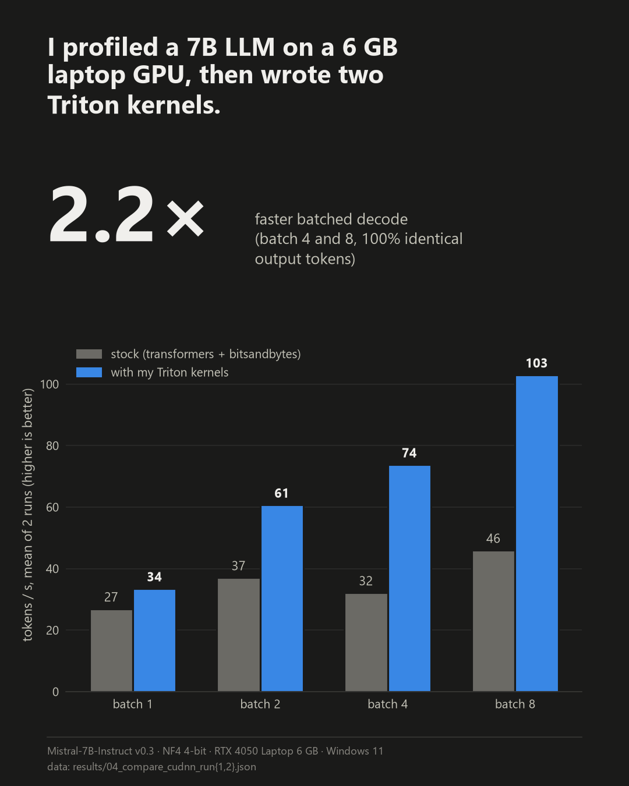
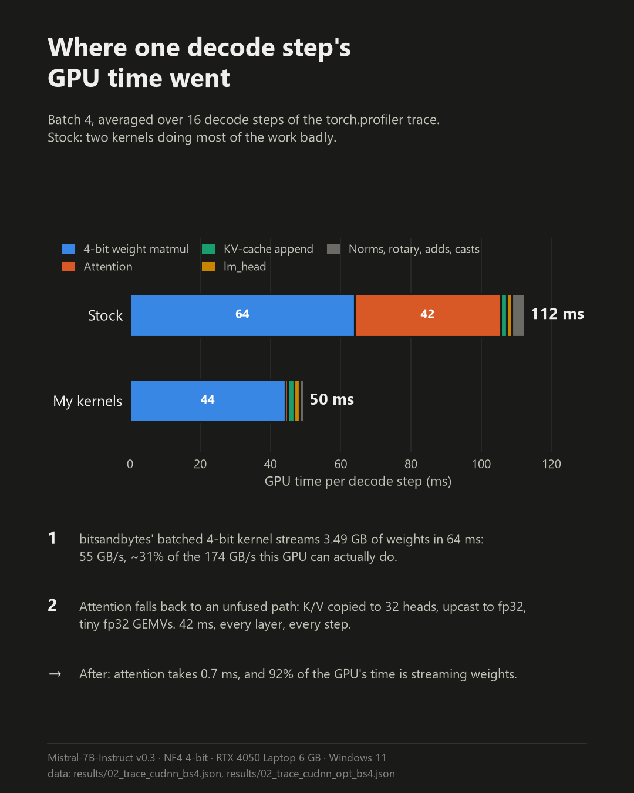

# Profiling and speeding up a 7B LLM on a 6 GB laptop GPU

I profiled Mistral-7B (4-bit) running in Hugging Face Transformers on an RTX 4050 Laptop GPU, found the two kernels
that made batched decoding slow, and replaced them with two Triton kernels I wrote.

**Result: 2.2× faster batched decode (46 → 103 tokens/s at batch 8), with 100% identical output tokens.**

<p align="center">
  
  
</p>

| Decode, ms per token | Stock | + Triton attention | + Triton 4-bit matmul | Speed-up |
|---|---|---|---|---|
| batch 1 | 35.8 – 38.4 | 29.6 – 30.6 | **29.8 – 30.0** | 1.2 – 1.3× |
| batch 2 | 53.6 – 54.2 | 32.9 – 33.5 | **32.8 – 33.1** | 1.6× |
| batch 4 | 119.5 – 129.3 | 73.1 – 74.4 | **53.1 – 55.3** | 2.2 – 2.4× |
| batch 8 | 172.4 – 175.4 | 77.7 – 77.8 | **77.5 – 77.8** | 2.2× |

Ranges are two separate clean runs. The greedy output tokens match the stock model exactly in every run.

**What's here**

- **[REPORT.md](REPORT.md):** the full analysis. Measured hardware ceilings, roofline position, where the time
  goes, the bottleneck verdict, and how each kernel was designed (including the version that was 8× slower).
- **[profiling/kernels/decode_attention.py](profiling/kernels/decode_attention.py):** flash-decoding attention with
  grouped-query heads. 2.5–7.5× faster than the stock path, up to 86% of DRAM bandwidth.
- **[profiling/kernels/nf4_gemm.py](profiling/kernels/nf4_gemm.py):** fused NF4 dequant + skinny matmul that reads
  bitsandbytes' 4-bit format in place. It runs only where it measured faster than bitsandbytes.
- **[profiling/](profiling/):** the measurement scripts. Every number in the report comes from them, and the raw
  outputs are in [results/](results/).

**Setup:** Mistral-7B-Instruct-v0.3 in 4-bit NF4 (bitsandbytes), PyTorch 2.11, Transformers 5, Triton 3.6,
RTX 4050 Laptop 6 GB (Ada, sm_89), Windows 11. FP16 weights for a 7B model take ~14.5 GB and won't fit in 6 GB,
so the model runs in 4-bit (~4.1 GB of weights). That choice shapes the whole bottleneck story (see §2.4).

The rest of this README is a learning guide to the tools and concepts behind the report.

```
profiling/
  common.py            model loading, exact-length prompts, CUDA-event timers, hardware microbenchmarks
  01_baseline.py       step 1: latency/throughput + % of roofline       -> results/01_baseline.json
  02_torch_profiler.py step 2: op/kernel breakdown, trace, GPU idle %   -> results/02_*
  trace_analysis.py    turns a torch.profiler trace into a bottleneck breakdown
  03_nsight_target.py  step 3: NVTX-annotated workload for nsys / ncu   -> results/nsys_*, ncu_*
  04_compare.py        step 4: stock vs custom kernels, one at a time   -> results/04_compare_*.json
  05_nsight.ps1        step 5: nsys timelines + ncu kernel reports, stock vs optimized
  kernels/
    nf4_gemm.py        Triton: fused NF4 dequant + skinny matmul (decode, 3-8 tokens per layer)
    decode_attention.py Triton: flash-decoding attention with grouped-query heads
    patch.py           swaps both into a loaded HF model (OPTIMIZED=1 does this in every script)
    bench_*.py         per-kernel correctness + speed vs the stock implementation
results/               everything the scripts produce
posts/make_images.py   renders the two images above from results/
```

Profiler traces are 70–100 MB each, too big for git. Only the two batch-4 traces are included, gzipped
(`results/02_trace_cudnn[_opt]_bs4.json.gz`). Run the scripts to regenerate the rest.

---

## 1. Quick start

Findings so far are in **[REPORT.md](REPORT.md)**.

```powershell
uv sync                                          # Python 3.12 + PyTorch (CUDA 12.8) + transformers + bitsandbytes
uv run python profiling/01_baseline.py           # ~3 min  -> results/01_baseline.json
$env:SDPA_BACKEND="cudnn"; uv run python profiling/01_baseline.py   # fused cuDNN attention for prefill -> *_cudnn.json
Remove-Item Env:SDPA_BACKEND
uv run python profiling/02_torch_profiler.py --batch 1   # ~1 min; add --memory for a memory snapshot
# Custom Triton kernels (REPORT.md §9):
uv run python profiling/kernels/bench_nf4.py         # kernel vs bitsandbytes on real weights
uv run python profiling/kernels/bench_attention.py   # kernel vs repeat_kv + SDPA
$env:SDPA_BACKEND="cudnn"; uv run python profiling/04_compare.py    # end to end, ~9 min
$env:OPTIMIZED="1"; uv run python profiling/02_torch_profiler.py --batch 4   # profile the optimized model
Remove-Item Env:OPTIMIZED
# Nsight (install first, see §4):
powershell -ExecutionPolicy Bypass -File profiling/05_nsight.ps1 -Batch 4
```

Before every measurement run, **plug in the laptop and set OMEN Gaming Hub / Windows power mode to
Performance**. Laptop GPUs change clocks with power and temperature, and on battery your numbers can
come out 2× worse.

---

## 2. Concepts you need first

### 2.1 Inference is two different workloads

| Phase | What happens | Tokens per forward pass | Typical bottleneck |
|---|---|---|---|
| **Prefill** | Process the whole prompt at once, fill the KV cache | hundreds to thousands | **Compute** (big matmuls) |
| **Decode** | Generate one token at a time, reading the KV cache | 1 per sequence | **Memory bandwidth** (+ CPU launch overhead) |

Users feel prefill as **TTFT** (time to first token) and decode as **tokens/s** or ms per token.
Always profile the two phases separately, because their bottlenecks differ and mixing them hides both.

### 2.2 The roofline model

Every kernel is limited by one of two things:

- **Compute**: peak FLOP/s (tensor cores)
- **Memory**: peak bytes/s from DRAM (VRAM)

**Arithmetic intensity** (AI) = FLOPs performed ÷ bytes moved from DRAM.
The **ridge point** = peak FLOP/s ÷ peak bytes/s. If AI < ridge, you are memory-bound; above it, compute-bound.

`01_baseline.py` *measures* both ceilings on your GPU (a big `copy_` for bandwidth, an 8192² FP16
matmul for FLOP/s) rather than trusting datasheet numbers. Measured ceilings are the honest
denominator for "% of peak".

### 2.3 Why decode is memory-bound

For one decode step at batch size `B`, every weight is read from VRAM once:

- FLOPs ≈ 2 × params × B   (each weight does one multiply-add per token)
- Bytes ≈ weight bytes + KV-cache bytes

With batch 1 and FP16 weights, AI ≈ 1 FLOP/byte, far below a ridge point of ~100+.
So the **floor for decode latency is `weight_bytes / bandwidth`**, and the closest you can get to it is
reading the weights at full bandwidth. Raising batch size reuses each weight read for B tokens,
which is why throughput scales almost linearly with batch until you approach the ridge or run out of
memory. `01_baseline.py` prints this floor next to the measured time ("roofline floor").

### 2.4 What 4-bit quantization changes

- Bytes per weight drop by ~4×, so the decode floor drops ~4×. That's the whole point.
- But the weights must be **dequantized** on the fly. bitsandbytes does it two ways:
  - **Decode (batch 1):** a fused `gemv_4bit` kernel that dequantizes and multiplies in one pass.
    Watch how close it gets to peak bandwidth.
  - **Prefill / larger batches:** a separate `kDequantize*` kernel writes FP16 weights, then cuBLAS runs a GEMM.
    That's extra memory traffic, and it shows up as its own category in the breakdown.
- Look for dequant time as a fraction of total. It's the price paid for fitting in 6 GB.

### 2.5 The hidden third bottleneck: CPU / launch overhead

A 7B decode step launches hundreds of small kernels (32 layers × ~20 ops). Each launch costs several µs
of Python + PyTorch dispatcher + CUDA driver time on the CPU (more on Windows/WDDM). If the CPU
can't enqueue kernels faster than the GPU runs them, the **GPU sits idle between kernels**. You'll
see this as gaps in the timeline and a high "GPU idle %" in `trace_analysis.py`.
The fixes are CUDA Graphs, `torch.compile(mode="reduce-overhead")`, kernel fusion, and larger batches.

---

## 3. The tool stack: zoom in one level at a time

| Level | Tool | Question it answers | Overhead |
|---|---|---|---|
| 0 | CUDA-event timers (`01_baseline.py`) | How fast? How far from the roofline? | none |
| 1 | **PyTorch Profiler** (`02`) | Which *PyTorch ops* and *kernels* take the time? Is the GPU idle? | low–medium |
| 2 | **Nsight Systems** `nsys` (`03`) | System-wide timeline: CPU threads, CUDA API calls, kernels, memcpys, gaps | low |
| 3 | **Nsight Compute** `ncu` (`03`) | *Why* is this one kernel slow? DRAM throughput, occupancy, stalls, per-kernel roofline | very high (replays each kernel many times) |

Rule of thumb: **start broad and cheap, then zoom in.** Never start with `ncu`. It tells you
everything about one kernel and nothing about whether that kernel matters.

### 3.1 PyTorch Profiler: what to look at

> **The profiler perturbs what it measures.** It adds CPU cost per op, so in launch-bound phases (decode
> at batch 1) its *GPU idle %* is inflated: here 73% under the profiler versus ~13% in reality. `--memory` adds
> far more. Trust its kernel durations and kernel mix; take latency from `01_baseline.py` and idle gaps from Nsight Systems.

`02_torch_profiler.py` writes (file names carry `_cudnn` when `SDPA_BACKEND` is set, and `_bs<N>`):

- **`results/02_ops_table_bs1.txt`**: operators sorted by self GPU time. Columns:
  - *Self CUDA*: GPU time of kernels launched directly by this op (use this to rank)
  - *CUDA total*: includes children
  - *Self CPU*: CPU time in the op itself. If CPU ≥ CUDA per op, you're launch-bound
  - *# of Calls*: decode at batch 1 has very many calls with tiny durations
- **`results/02_trace_bs1.json`**: open at <https://ui.perfetto.dev>. Find the `decode_step_*` ranges on the
  CPU thread, then look at the GPU stream row underneath. **Gaps in the GPU row = idle GPU.**
  Shortcuts: `W/S` zoom, `A/D` pan, click a kernel to see its launching op (flow arrow).
- **`results/02_breakdown_bs1.json`**: computed by `trace_analysis.py`:
  - `gpu_idle_pct`: share of the step's GPU-timeline span where no kernel ran
  - `kernels_per_step`, `avg_kernel_us`: many tiny kernels mean launch overhead dominates
  - `time_by_category_pct`: matmul vs 4-bit dequant vs attention vs elementwise
- **`--memory` → `results/02_memory_bs1.pickle`**: drag it into <https://pytorch.org/memory_viz> to see
  weights, KV-cache growth, and activation spikes during prefill.

### 3.2 Nsight Systems: what to look at

```powershell
nsys profile -t cuda,nvtx,cublas --capture-range=cudaProfilerApi --capture-range-end=stop `
  --cuda-memory-usage=true -o results/nsys_decode -f true .venv/Scripts/python.exe profiling/03_nsight_target.py
nsys stats --report cuda_gpu_kern_sum,cuda_api_sum,nvtx_sum results/nsys_decode.nsys-rep
```
Use the venv's `python.exe` directly instead of `uv run`, so the profiler attaches to the right process.

Open `results/nsys_decode.nsys-rep` in the Nsight Systems GUI:

- **NVTX row**: `prefill` and `decode_step` ranges, projected onto the GPU
- **CUDA HW row**: kernel blocks. Dense = GPU-bound, sparse with gaps = CPU-bound
- **CUDA API row** (on the Python thread): `cudaLaunchKernel` calls. If they line up 1:1 with
  kernels and kernels start immediately after launch, the CPU is the pacer
- `cuda_api_sum`: total time in `cudaLaunchKernel` / `cudaStreamSynchronize`
- `cuda_gpu_kern_sum`: kernel time ranking, a cross-check against the PyTorch profiler

### 3.3 Nsight Compute: what to look at

```powershell
ncu --nvtx --nvtx-include "decode_step/" --launch-count 40 --set full `
    -o results/ncu_decode -f .venv/Scripts/python.exe profiling/03_nsight_target.py --steps 2
```
Open `results/ncu_decode.ncu-rep` in Nsight Compute and pick the top kernel from step 2
(e.g. the 4-bit gemv). Then check:

- **GPU Speed Of Light**: Memory % vs Compute (SM) %. A memory-bound kernel should show Memory % ≫ SM %.
  If both are low, the kernel is latency-bound (too small, poor occupancy).
- **Memory Workload Analysis**: DRAM throughput (GB/s) and bytes read. Compare against the measured peak.
- **Roofline chart**: where this kernel sits relative to the memory and compute ceilings
- **Occupancy** and **Warp State Statistics**: why warps stall (e.g. "Long Scoreboard" = waiting on memory)

---

## 4. Installing Nsight on Windows

1. **Nsight Systems**: <https://developer.nvidia.com/nsight-systems/get-started> (Windows installer).
   Add `C:\Program Files\NVIDIA Corporation\Nsight Systems <ver>\target-windows-x64` to `PATH` for `nsys`.
2. **Nsight Compute**: <https://developer.nvidia.com/nsight-compute> (or install the CUDA Toolkit, which bundles both).
   `ncu` lives in `C:\Program Files\NVIDIA Corporation\Nsight Compute <ver>\`.
3. **Allow GPU performance counters** (otherwise `ncu` fails with `ERR_NVGPUCTRPERM`):
   NVIDIA Control Panel → Desktop menu → *Enable Developer Settings* → Developer → *Manage GPU
   Performance Counters* → *Allow access to the GPU performance counters to all users*.
   (Or run the terminal as Administrator.)

---

## 5. Bottleneck decision tree

```
Measure step time T, compute the roofline floor T_min = max(FLOPs/peak_FLOPs, bytes/peak_BW)
│
├─ T ≈ T_min (≥ ~70%)            → at the hardware limit. Only less work helps:
│                                   fewer bytes (quantize, smaller KV cache) or fewer FLOPs.
│
└─ T ≫ T_min → find where the time goes:
     ├─ GPU idle % high (gaps in timeline, CPU time/step ≥ GPU busy/step)
     │      → CPU / launch-bound: CUDA Graphs, torch.compile, fusion, bigger batch
     ├─ GPU busy, but top kernel's DRAM throughput ≪ peak (ncu)
     │      → inefficient kernel: bad memory access pattern, low occupancy, too-small grid.
     │        Try a better kernel (different quant backend, FlashAttention, fused ops)
     ├─ Big share in "overhead" kernels (dequant, copies, elementwise, cat)
     │      → fuse them or pick a format with fused kernels
     └─ Memory pressure / OOM → memory snapshot: KV cache vs activations vs fragmentation
```

---

## 6. Report outline (fill from `results/`)

1. **Setup**: hardware, measured ceilings (bandwidth, TFLOPS, ridge point), software versions, model + quantization
2. **Baseline performance**: TTFT vs prompt length, decode ms/token + tokens/s vs batch, VRAM use
3. **Roofline position**: % of peak compute (prefill) and % of peak bandwidth (decode); AI of each phase vs ridge
4. **Where the time goes**: category breakdown, top kernels, GPU idle %, kernels/step (torch.profiler + nsys screenshots)
5. **Kernel deep dive**: top decode kernel in ncu (SOL %, DRAM GB/s, occupancy, stall reasons)
6. **Bottleneck verdict**: for each phase, what limits it and the evidence
7. **Recommendations / experiments**: e.g. batch scaling, CUDA Graphs / torch.compile, other quant formats, with expected gains from the roofline
